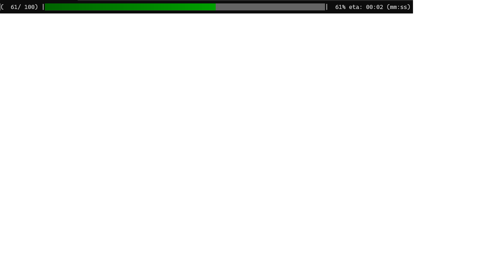

# Progress bar in ANSI C for ascii terminals



This is a really simple progressbar implementation in ANSI C99.
I want it to be beautiful yet simple. General yet not requiring
much configuration.

Super simple API. Only one function:
```c
#include "progress.h"
#define MAX_COUNT 100
int main()
{
    for(int i=0; i <= MAX_COUNT; i++ ){
        /* Do something */
        progress_ascii( i, MAX_COUNT, "Some text: ");
    }
    return 0;
}
```

I have added some flexibility in the leading text by having the function variadic, just like a printf()
You can hence call the function like:

```c
        progress_ascii( i, maxvalue, "(%4d/%4d) ", i, maxvalue);
```

## Estimated time

I have added the feature to estimate the ETA of a long process. This feature
sets a start time when the call to `progress_ascii()` gets 0 as it first
argument.

Please note that you probably want to call the function with a final 100%
value as well. In that case the total spent time is reported.

So... Make sure that you call the function with both 0 at start and 100%-value at the end.

## Tips and caveats
If you have a very long run with frequent updates, remember that printing a progressbar like this also takes
resources. This is especially true if you in addition run it on a remote machine over SSH or something. In that
case the host machine will use resources to encrypt the text and the client has to decrypt. It can hence be a lot
of overload if you call this function too often.

To mitigate such overload you can limit the number of calls by adding a modulo calc before calling. like:
```c
    if( (i % 100 ) == 0 )
         progress_ascii( i, maxvalue, "(%4d/%4d) ", i, maxvalue);
```
Or if you want a update each second you can do something like:
```c
#include <time.h>
..
    time_t prev_update, now;
    for ( int i = 0; i < maxvalue; i++ ){
        /* Do something */
        if ( i == 0 || i == maxvalue || time(&now) - prev_update > 1 ){
            progress_ascii( i, maxvalue, "(%4d/%4d) ", i, maxvalue);
            time( &prev_update );
        }
    }
```
... or something... you'll think of something.
